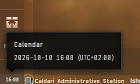

# EveJS Localtime zone Patch

The Neocom clock shows the time on each player's computer, in that player's
timezone. Summer/winter time follows the operating system's daylight saving
settings. The date tooltip also shows the local date, time and UTC offset.
No menu, settings or timezone configuration are required.

*Screenshot from version 0.1.0 on the previous server release.*

[Download v0.1.1](https://github.com/V0nCleef/EveJS-Localtime-zone-Patch/releases/download/v0.1.1/EveJS-Localtime-zone-Patch-0.1.1.zip)
or visit the [release page](https://github.com/V0nCleef/EveJS-Localtime-zone-Patch/releases/tag/v0.1.1).

Version 0.1.1 is checked against EveJS 0.12.9 and 261018.1 Native with the
build-3396210 Windows client. The listed server versions are advisory: a newer
version may be tried if its handshake still matches an exact reviewed source
baseline. Changed login code keeps this mod inactive. Other versions are not
thereby declared tested. Docker and other client builds remain unverified.

## Install

In the EveJS Launcher, use Mods -> Add ZIP and select
`EveJS-Localtime-zone-Patch-0.1.1.zip`. Enable the mod, restart Game, then
reconnect each EVE client. A client already logged in keeps its old clock until
it reconnects to a server started with the mod enabled.

If version 0.1.0 is already installed, stop Game and remove its Localtime entry
through Mods before adding the 0.1.1 ZIP. This mod has no saved configuration
to transfer. Enable the new entry, restart Game, and reconnect clients.

For a manual Native launch, extract this package under `mods/LocaltimeZonePatch`
and preload `loader.js` with Node's `--require` before `server/index.js`.

## Behavior

- Each client reads its own PC's timezone. The server administrator's timezone
  is not sent to players. Different players can see different clock times.
- The clock refreshes every five seconds, matching the original widget.
- Windows applies its current timezone and daylight saving rules on each
  refresh. If automatic DST is disabled in Windows, the mod respects that.
- The tooltip uses an unambiguous local date and UTC offset, for example
  `2026-10-10 15:35 (UTC+02:00)`. Clicking still opens the normal calendar.
- If native Windows timezone access is unavailable, Python's OS local-time
  conversion is used. No location lookup or network service is involved.

Only the Neocom clock's display and date tooltip change. Server timestamps,
simulation time, skill queues, market expiry, calendar events, other clock
widgets and other game timestamps keep their original behavior.

## Disable or remove

Disable/remove this mod in the Launcher, restart Game, and reconnect clients.
The mod restores its runtime UI hooks on disconnect. It never edits `code.ccp`,
EveJS source, Windows time settings, or player databases. An unsupported login
builder or widget leaves the mod inactive and preserves normal login/time.

For troubleshooting, the server prints `[EveJS Localtime zone Patch]` status.
The client records a small status log at
`cache:/evejs-localtime-zone-patch.log`; successful attachment is
`EVEJS_LOCALTIME:READY:0.1.1`. The log contains no character or account data.

## Verification

See `VERIFICATION.md` for the checks and the limit of live in-game coverage.
